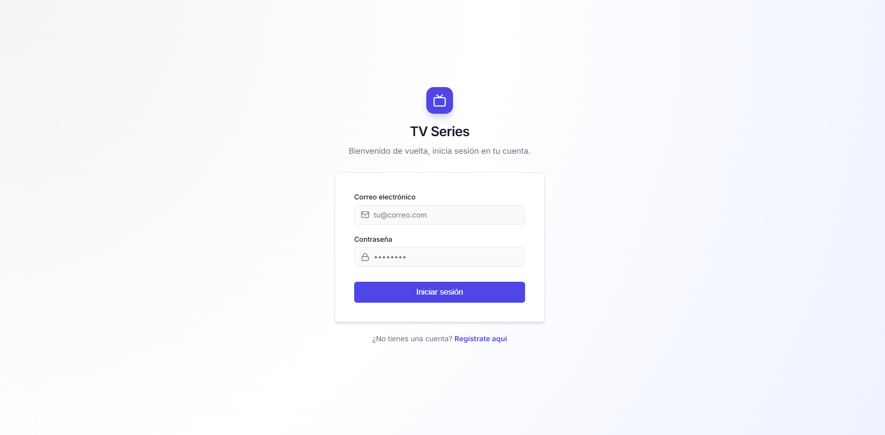
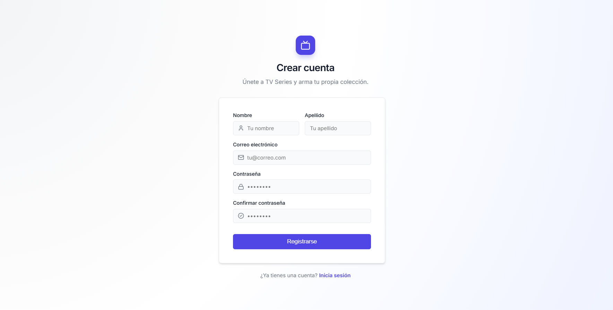
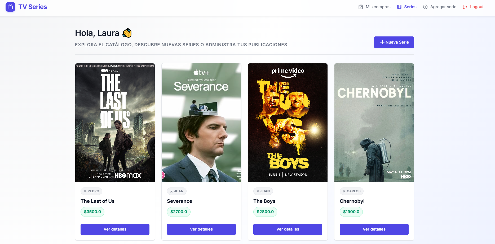
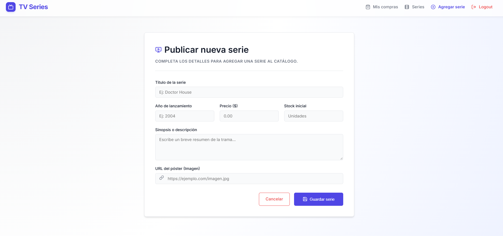
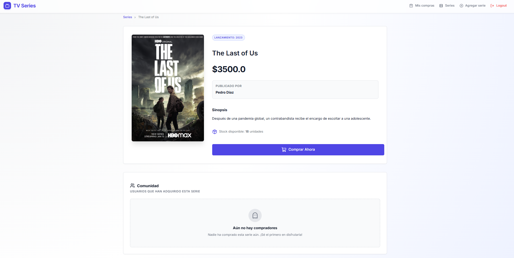
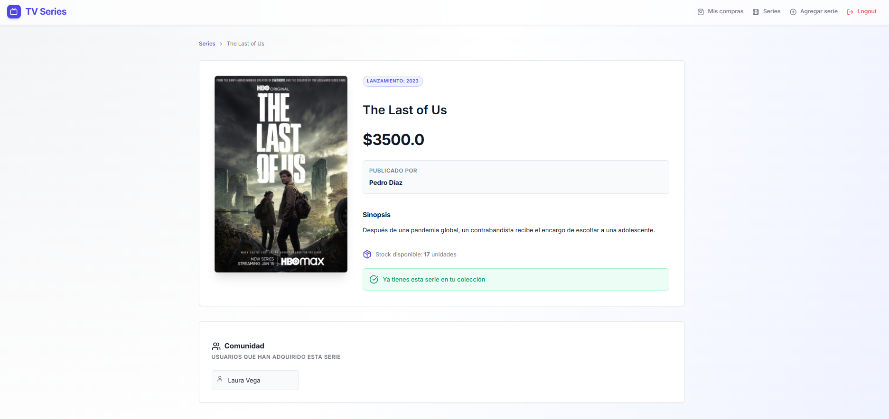
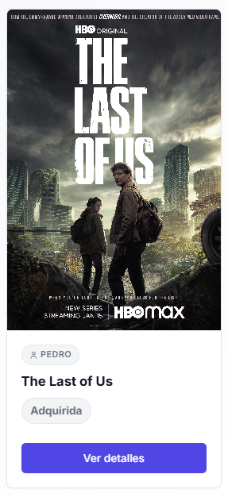
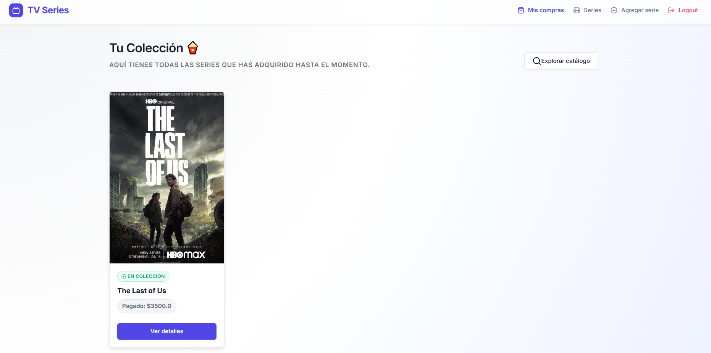
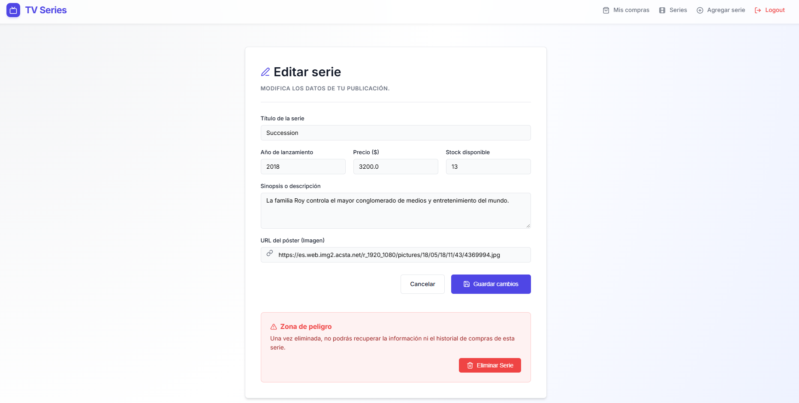

# 📺 TV Series - Sistema de Gestión y Adquisición de Series

> Proyecto desarrollado como examen de certificación para el Bootcamp Full Stack Java impartido por Skillnest y patrocinado por Banco de Chile.

**TV Series** es una aplicación web Full Stack desarrollada en Java utilizando el framework **Spring Boot** bajo el patrón de arquitectura **MVC** (Modelo-Vista-Controlador). Permite a los usuarios registrarse, iniciar sesión, gestionar un catálogo de series de televisión (crear, editar, eliminar) y simular la "compra" de las mismas, manejando inventario y relaciones complejas de bases de datos.

## 🚀 Funcionalidades Principales
* **Autenticación Segura:** Sistema de registro y login de usuarios con contraseñas encriptadas usando BCrypt.
* **Gestión de Sesiones:** Rutas protegidas que aseguran que solo los usuarios autenticados puedan acceder a las funcionalidades del sistema.
* **CRUD de Series:** Los usuarios pueden agregar nuevas series, ver el catálogo completo, visualizar detalles específicos, editar y eliminar las series que ellos mismos hayan creado.
* **Sistema de Compras:** Los usuarios pueden adquirir series disponibles. La aplicación descuenta automáticamente la cantidad del inventario y asocia la serie al perfil del comprador.
* **Validación de Datos:** Uso de Jakarta Validation en backend para asegurar que los datos ingresados en los formularios cumplan con requisitos estrictos (longitud, formato de correo, URLs válidas de imágenes, precios positivos, etc.).

## 🛠️ Stack Tecnológico
* **Backend:** Java 17, Spring Boot (Web, MVC).
* **Persistencia de Datos:** Spring Data JPA (Hibernate), MySQL Connector.
* **Frontend:** JSP (JavaServer Pages), JSTL, HTML5, CSS3.
* **Seguridad:** jBcrypt (Hashing de contraseñas).
* **Gestor de Dependencias:** Maven.

## 📋 Requisitos
Para ejecutar este proyecto en tu entorno local, necesitarás tener instalado:
* **Java Development Kit (JDK)** versión 17 o superior.
* **Maven** (para la gestión de dependencias y construcción del proyecto).
* **MySQL Server** (ejecutándose localmente o remotamente).
* Un IDE compatible con Java (como Eclipse, IntelliJ IDEA o VS Code con el Extension Pack for Java).

## ⚙️ Configuración de Base de Datos
El proyecto está configurado para conectarse a una base de datos MySQL local. Antes de ejecutar la aplicación, asegúrate de:

1. Abrir tu gestor de base de datos MySQL (ej. MySQL Workbench o XAMPP).
2. Crear un esquema (base de datos) llamado `tvSeries_db`:
   
   ```sql
   CREATE DATABASE tvSeries_db;
   ```
4. Si tus credenciales de MySQL son distintas a las configuradas por defecto en el archivo `application.properties`, actualízalas:
   
   ```properties
   spring.datasource.url=jdbc:mysql://localhost:3306/tvSeries_db
   spring.datasource.username=TU_USUARIO
   spring.datasource.password=TU_CONTRASEÑA
   ```
   *(Nota: Por defecto, el proyecto usa `root` como usuario y contraseña).*

## 🏃‍♂️ Pasos para correrlo
1. Clona este repositorio en tu máquina local:
   
   ```bash
   git clone https://github.com/CristinaTiznado/ExamenSeries.git
   ```
3. Navega hasta el directorio del proyecto:
   
   ```bash
   cd ExamenSeries
   ```
5. Instala las dependencias y compila el proyecto usando Maven:
   
   ```bash
   mvn clean install
   ```
7. Ejecuta la aplicación de Spring Boot:
   
   ```bash
   mvn spring-boot:run
   ```
9. Abre tu navegador web y visita: **`http://localhost:8080`**

## 💡 Uso de la Aplicación
1. **Inicio y Registro:** Al entrar a la aplicación, verás la pantalla de Login. Si es tu primera vez, dirígete a "Registro" para crear una cuenta (tu contraseña será encriptada).

   

   
   
2. **Explorar Catálogo:** Una vez dentro, verás el panel principal con todas las series subidas por la comunidad.

   
   
4. **Agregar Serie:** Ve a la pestaña "Agregar serie" para publicar un nuevo título, asegurándote de proporcionar una URL de imagen válida y cantidad en stock.

   

   
   
6. **Comprar Serie:** Haz clic en la imagen de una serie en el catálogo para ver su detalle. Si hay inventario disponible y no la has comprado aún, podrás hacer clic en "Comprar".

   

   

   
   
8. **Mis Compras:** Revisa tu biblioteca personal en la sección "Mis compras" para ver todas las series que has adquirido.

   
   
10. **Administrar:** Si tú fuiste el creador de una serie, verás un ícono de edición (✎) que te permitirá actualizar su información o eliminarla del sistema.

   
    
