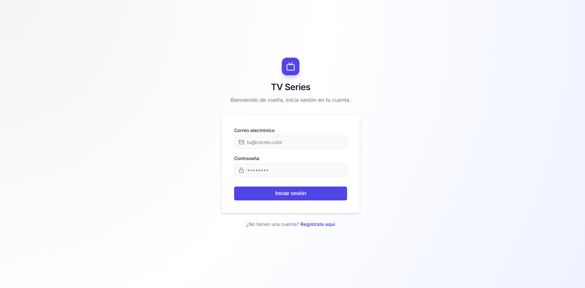
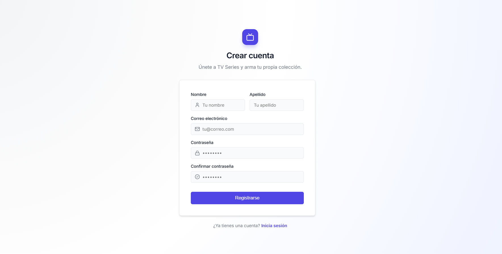
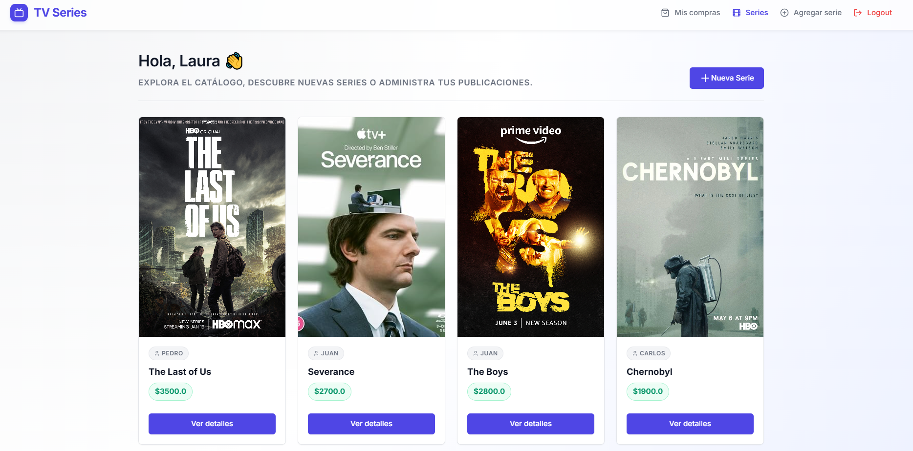
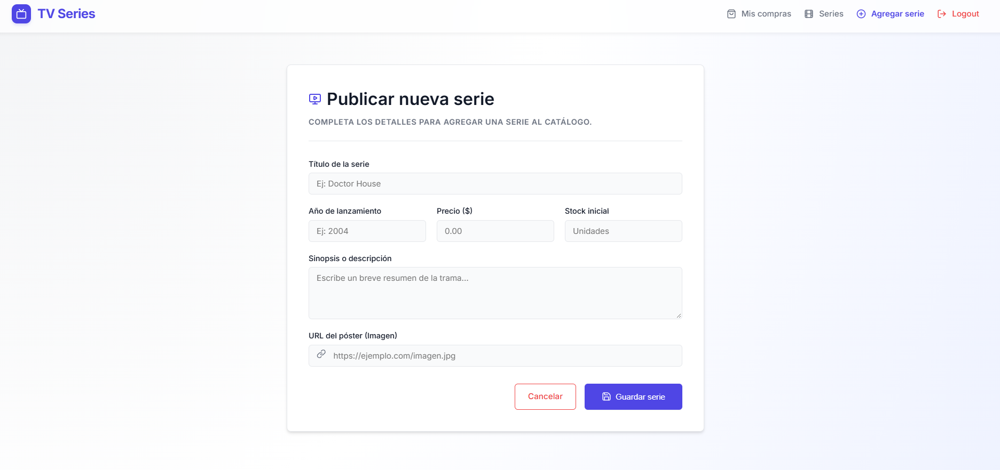
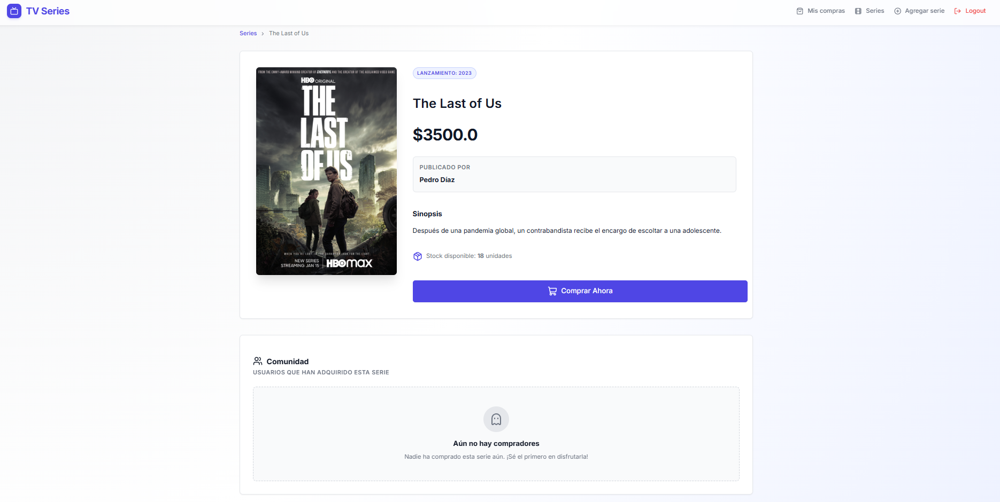
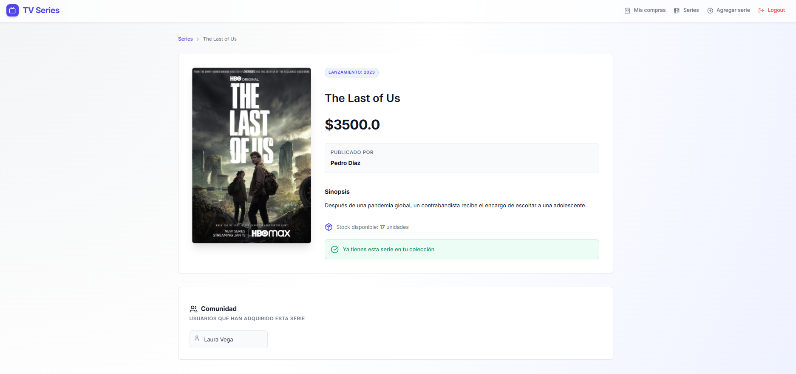
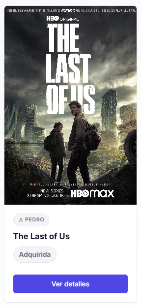
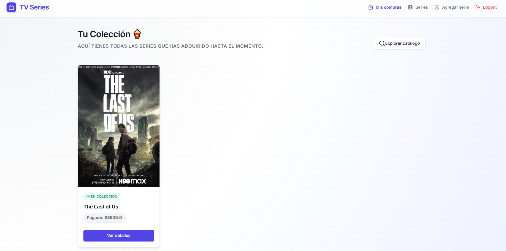
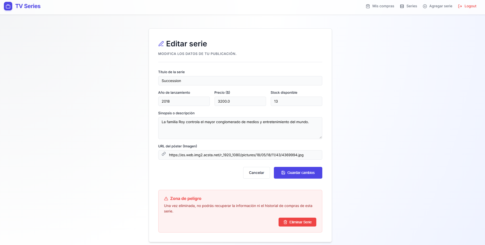

🌍 Leer en [Español](README-es.md)*

# 📺 TV Series - Series Management and Acquisition System

> Project developed as a certification exam for the Full Stack Java Bootcamp taught by Skillnest and sponsored by Banco de Chile.

**TV Series** is a Full Stack web application developed in Java using the **Spring Boot** framework under the **MVC** (Model-View-Controller) architectural pattern. It allows users to register, log in, manage a TV series catalog (create, edit, delete), and simulate the "purchase" of these series, handling inventory and complex database relationships.

## 🚀 Main Features
- **Secure Authentication:** User registration and login system with passwords encrypted using BCrypt.
- **Session Management:** Protected routes ensuring that only authenticated users can access the system's functionalities.
- **TV Series CRUD:** Users can add new series, view the complete catalog, see specific details, and edit or delete the series they have created themselves.
- **Purchase System:** Users can acquire available series. The application automatically deducts the quantity from the inventory and associates the series with the buyer's profile.
- **Data Validation:** Use of Jakarta Validation on the backend to ensure data entered in forms meets strict requirements (length, email format, valid image URLs, positive prices, etc.).

## 🛠️ Tech Stack
- **Backend:** Java 17, Spring Boot (Web, MVC).
- **Data Persistence:** Spring Data JPA (Hibernate), MySQL Connector.
- **Frontend:** JSP (JavaServer Pages), JSTL, HTML5, CSS3.
- **Security:** jBcrypt (Password Hashing).
- **Dependency Management:** Maven.

## 📋 Requirements
To run this project in your local environment, you will need to have installed:
- **Java Development Kit (JDK)** version 17 or higher.
- **Maven** (for dependency management and project building).
- **MySQL Server** (running locally or remotely).
- A Java-compatible IDE (such as Eclipse, IntelliJ IDEA, or VS Code with the Extension Pack for Java).

## ⚙️ Database Configuration
The project is configured to connect to a local MySQL database. Before running the application, make sure to:

1. Open your MySQL database manager (e.g., MySQL Workbench or XAMPP).
2. Create a schema (database) named `tvSeries_db`:
   
   ```sql
   CREATE DATABASE tvSeries_db;
   ```
3. If your MySQL credentials are different from the defaults configured in the `application.properties` file, update them:
   
   ```properties
   spring.datasource.url=jdbc:mysql://localhost:3306/tvSeries_db
   spring.datasource.username=YOUR_USERNAME
   spring.datasource.password=YOUR_PASSWORD
   ```
   *(Note: By default, the project uses `root` for both username and password).*

## 🏃‍♂️ Steps to Run
1. Clone this repository to your local machine:
   
   ```bash
   git clone https://github.com/CristinaTiznado/ExamenSeries.git
   ```
2. Navigate to the project directory:
   
   ```bash
   cd ExamenSeries
   ```
3. Install dependencies and compile the project using Maven:
   
   ```bash
   mvn clean install
   ```
4. Run the Spring Boot application:
   
   ```bash
   mvn spring-boot:run
   ```
5. Open your web browser and visit: **`http://localhost:8080`**

## 💡 Application Usage
1. **Home and Registration:** Upon entering the application, you will see the Login screen. If it is your first time, go to "Register" to create an account (your password will be encrypted).
   
   

   
   
2. **Explore Catalog:** Once logged in, you will see the main dashboard with all the series uploaded by the community.

   
   
3. **Add Series:** Go to the "Add series" tab to publish a new title, making sure to provide a valid image URL and stock quantity.

   

   
   
4. **Buy Series:** Click on a series image in the catalog to see its details. If there is inventory available and you haven't bought it yet, you can click "Buy".

   

   

   
   
5. **My Purchases:** Check your personal library in the "My purchases" section to see all the series you have acquired.

    
   
6. **Manage:** If you were the creator of a series, you will see an edit icon (✎) that will allow you to update its information or remove it from the system.

    
